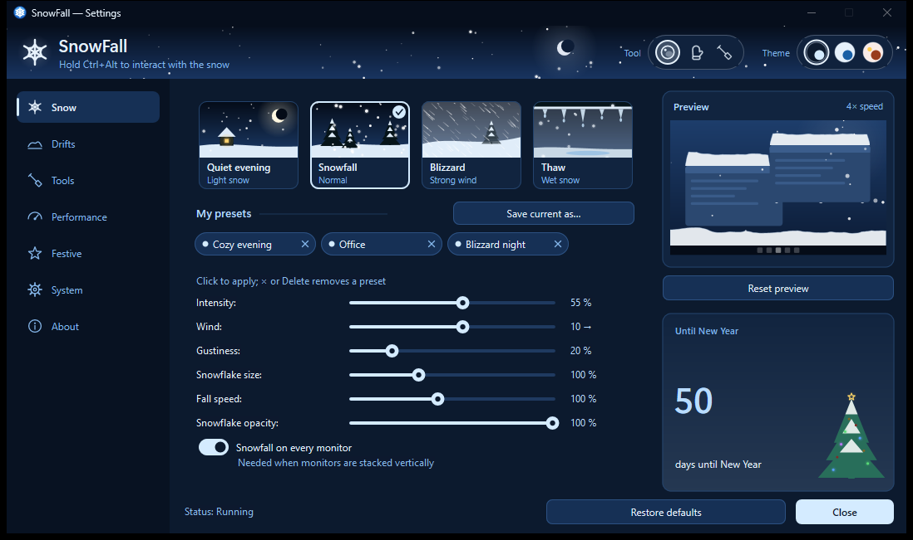
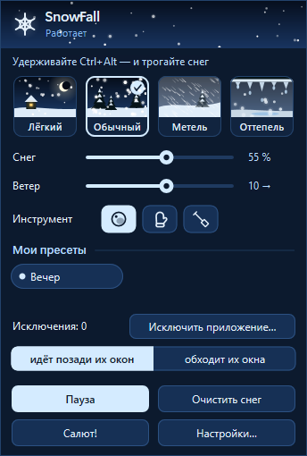
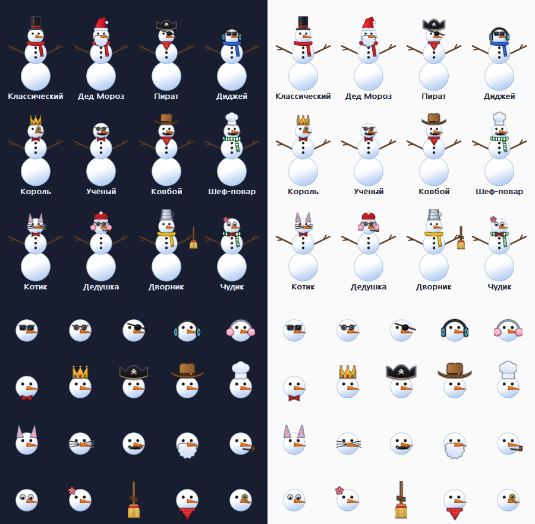
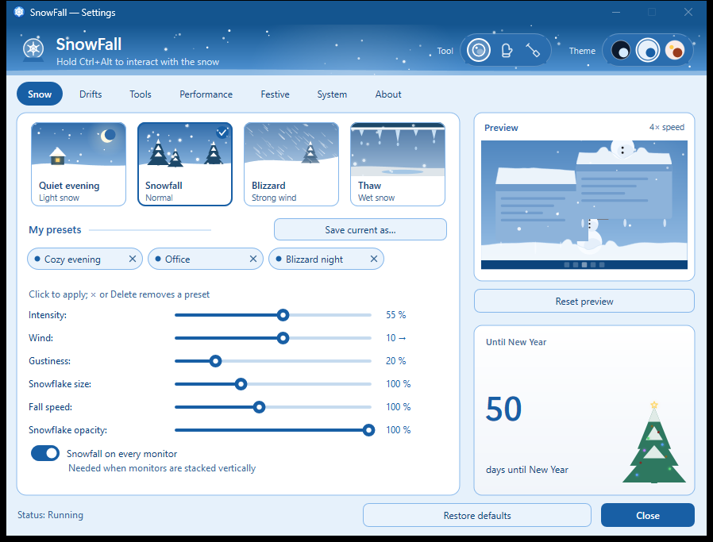
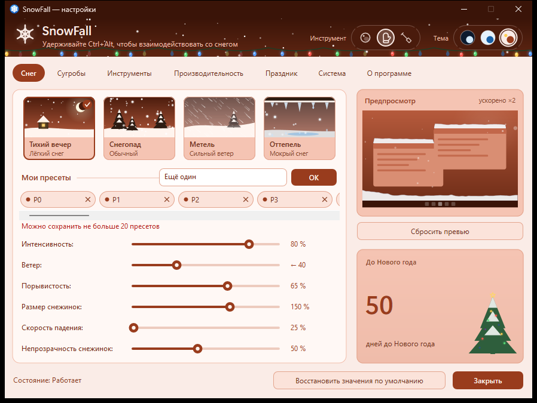

# SnowFall

Interactive snow for your desktop. Snowflakes settle on the top edges of your windows and the
taskbar, build up into drifts and travel with the windows. Brush the snow away, scoop and fling
it with a shovel, roll snowballs, throw them at windows, and build snowmen — by hand or by
stacking three balls. A toy snowplow clears the taskbar when it gets buried.

**Platforms:** Windows 11 x64 and, as a test build, macOS 13+ (Apple Silicon and Intel).
[Русская версия README](README.ru.md)

**[Download the latest version](../../releases/latest)**



## Features

- **Snow that lives on your desktop**: drifts on window tops, the taskbar and the screen bottom,
  hidden behind overlapping windows, carried along when a window moves, shaken off in chunks
  when you jerk a window, lumpy natural caps, icicles under long-lying snow.
- **Weather**: Light, Normal, Blizzard and Thaw (wet snow, melting drifts, dripping icicles),
  wind and gusts, snow that flows around the mouse pointer like under an umbrella.
- **Tools** (hold `Ctrl+Alt` on Windows / `Ctrl+Option` on macOS, or toggle interaction mode):
  - **Snowball** — roll a ball out of a drift, throw it (it splats on windows); balls stick
    together, and three stacked balls turn into a snowman with a little sparkling transformation;
  - **Mitten** — press and hold on a drift to sculpt a snowman; a quick swipe brushes snow away;
  - **Shovel** — scoop snow and fling it; it lands as a new mound; knocks snowmen over.
- **Snowmen** with 12 skins (Santa, pirate, DJ, king, kitty…), falling from the sky during
  heavy snow (configurable), falling apart realistically when plowed or shoveled.
- **Festive extras**: taskbar garland, New Year's midnight fireworks (or any time on demand).
- **Three settings themes** with a live preview, a quick panel next to the tray icon, user
  presets, per-application exclusions (snow passes behind or flows around their windows).
- **Lightweight and private**: about 0.2–0.5 % CPU, ~35 MB RAM, auto-pause for fullscreen apps,
  locked sessions and sleep. No telemetry, no reading of other windows' contents, no injection,
  no admin rights. The only network use is the optional update check (asked once): one request
  a day to the GitHub Releases API with nothing about you; updates are installed only from
  signed releases.

| Quick panel | Snowman skins |
|---|---|
|  |  |

| "Snow globe" theme | "New Year card" theme |
|---|---|
|  |  |

## Install

**Windows 11 x64:** download `SnowFallSetup.exe` from [Releases](../../releases/latest)
(per-user install, no admin rights; uninstall from Settings → Apps), or the portable zip.

> Builds are not code-signed yet, so Windows SmartScreen may warn on first launch
> (More info → Run anyway).

**macOS 13+:** download `SnowFall-<version>.dmg` and drag SnowFall to Applications. The app is not
notarized, so macOS refuses the first launch ("could not be verified" or "is damaged"). Either run

```sh
xattr -cr /Applications/SnowFall.app
```

or click "Done", then System Settings → Privacy & Security → "Open Anyway". Clicking the snow
needs the Accessibility permission (the app asks the first time you hold Ctrl+Option).

Updates: Settings → About → Updates (or automatically once a day if you allowed it).

## Usage

- **Tray icon** (Windows): left click — quick panel, double click — settings, right click — menu.
  On macOS the snowflake in the menu bar works the same way.
- **Hotkeys** (configurable): `Ctrl+Alt+S` — pause, `Ctrl+Alt+X` — clear snow,
  `Ctrl+Alt+I` — interaction mode.
- Settings are stored in `%LOCALAPPDATA%\SnowFall\settings.json`, the log `snowfall.log` next to
  it (no window titles or personal data).

## Feedback

Bugs and ideas — in [Issues](../../issues), ideally with a screenshot and the log
(Windows: Settings → Performance → «Open log folder»; macOS: `~/Library/Logs/SnowFall/snowfall.log`).

## License

SnowFall is free for personal and other noncommercial use under the
[PolyForm Noncommercial License 1.0.0](LICENSE.md). **Commercial use requires a separate
license** — contact the author via [GitHub](https://github.com/DaveBugg) or
[Telegram](https://t.me/dave_cli).

This repository hosts the releases; the source code is not published.

SnowFall is an independent project and is not affiliated with any other desktop-snow product.
