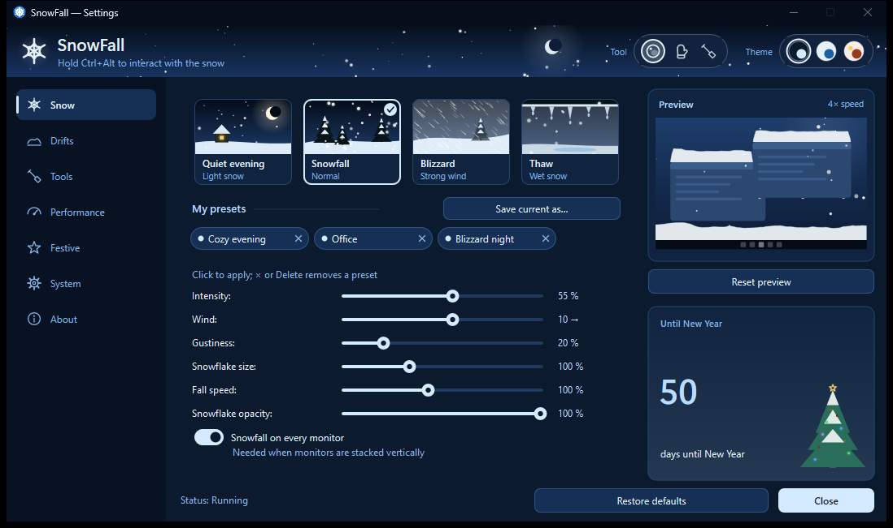
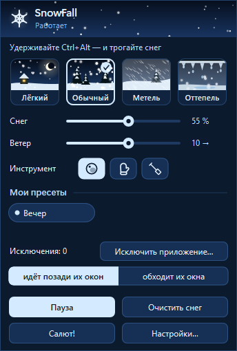
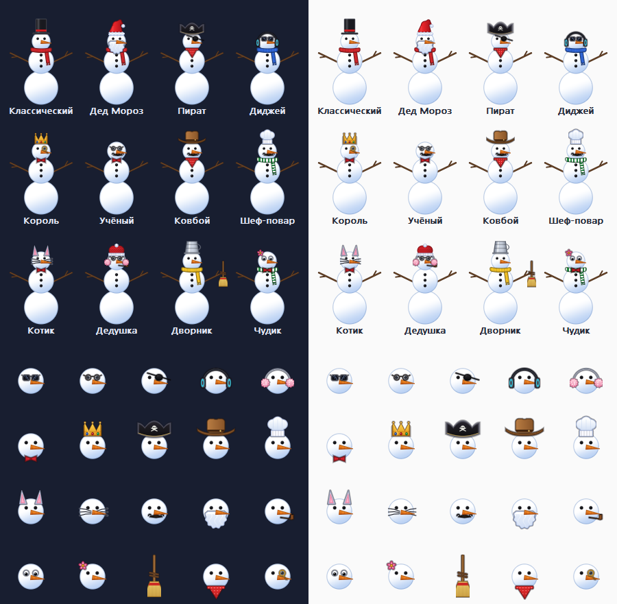
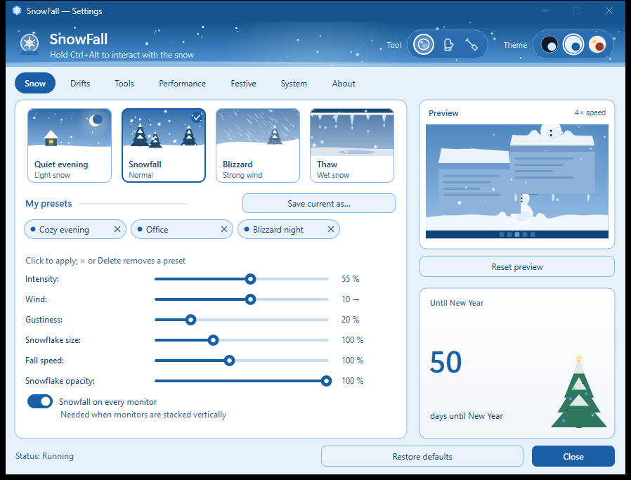
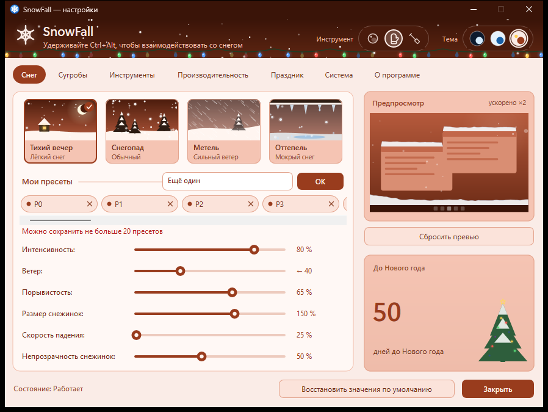

# SnowFall

Interactive snow for your desktop. Snowflakes settle on the top edges of your windows and the
taskbar, build up into drifts and travel with the windows. Brush the snow away, scoop and fling
it with a shovel, roll snowballs, throw them at windows, and build snowmen — by hand or by
stacking balls. A toy snowplow clears the taskbar when it gets buried.

**Platforms:** Windows 11 x64 (native C++20, Win32 + Direct3D 11) and, as a first test build,
macOS 13+ (Objective-C++, Metal, SwiftUI; Apple Silicon and Intel) — see
[platform/macos](platform/macos/README.md).
[Русская версия README](README.ru.md)



## Features

- **Snow that lives on your desktop**: drifts on window tops, the taskbar and the screen bottom,
  hidden behind overlapping windows, carried along when a window moves, shaken off in chunks
  when you jerk a window, lumpy natural caps, icicles under long-lying snow.
- **Weather**: Light, Normal, Blizzard and Thaw (wet snow, melting drifts, dripping icicles),
  wind and gusts, snow that flows around the mouse pointer like under an umbrella.
- **Tools** (hold `Ctrl+Alt` or the shown chord, or toggle interaction mode):
  - **Snowball** — roll a ball out of a drift, throw it (it splats on windows), stack balls
    into snowmen;
  - **Mitten** — press and hold on a drift to sculpt a snowman; a quick swipe brushes snow away;
  - **Shovel** — scoop snow and fling it; it lands as a new mound; knocks snowmen over.
- **Snowmen** with 12 skins (Santa, pirate, DJ, king, kitty…), falling from the sky during
  heavy snow (configurable), falling apart realistically when plowed or shoveled.
- **Festive extras**: taskbar garland, New Year's midnight fireworks (or any time on demand).
- **Three settings themes** with a live preview, a quick panel next to the tray icon, user
  presets, per-application exclusions (snow passes behind or flows around their windows).
- **Lightweight and private**: about 0.2–0.5 % CPU, ~35 MB RAM, auto-pause for fullscreen apps,
  locked sessions and sleep. No network access, no telemetry, no reading of other windows'
  contents, no injection, no admin rights.

| Quick panel | Snowman skins |
|---|---|
|  |  |

| "Snow globe" theme | "New Year card" theme |
|---|---|
|  |  |

## Install

Download `SnowFallSetup.exe` from [Releases](../../releases) (per-user install, no admin
rights; uninstall from Settings → Apps), or the portable zip.

> Builds are not code-signed yet, so Windows SmartScreen may warn on first launch.

**macOS:** download `SnowFall-<version>.dmg` and drag SnowFall to Applications. The app is not
notarized, so macOS refuses the first launch ("could not be verified" or "is damaged"). Either run

```sh
xattr -cr /Applications/SnowFall.app
```

or click "Done", then System Settings → Privacy & Security → "Open Anyway". Clicking the snow
needs the Accessibility permission (the app asks the first time you hold Ctrl+Option).

## Build from source

Requirements: Visual Studio 2022 Build Tools (MSVC x64, Windows SDK 10.0.22621+),
CMake ≥ 3.24, Ninja.

```bat
build.bat build Release          :: everything into build\
build\SnowFall.exe               :: run
```

Packaging: `platform\windows\packaging\make_portable.bat` (zip),
`platform\windows\packaging\make_msix.bat` (unsigned MSIX); the installer `SnowFallSetup.exe`
is built together with the app. See [platform/windows/packaging](platform/windows/packaging/README.md).

## Tests

| Command (in `build\`) | What it covers |
|---|---|
| `snow_sim_tests` | physics, drifts, occlusion, tools, snowmen, snowplow, festive effects, benchmark |
| `snow_settings_tests`, `snow_settings_win_tests` | JSON, migrations, ranges, presets, hotkeys, file I/O, autostart |
| `tracker_dump --selftest` | window tracking on real windows: Z-order, minimize, fullscreen, coalescing |
| `render_demo --selftest` | transparency, click-through, frame pacing, device-loss recovery, clipping |
| `ui_demo --selftest` | tray, quick panel and settings window in all themes, RU/EN, 100–200 % DPI |
| `e2e_smoke <SnowFall.exe>` | the real app end to end: snow settles, moves with a window, clears, exits cleanly |
| `soak_test --minutes 480` | long run: memory, handles, CPU, hangs |

Tests read screen pixels only inside their own test windows.

## Repository layout

```
core/               portable C++20: simulation, drifts, tools, snowmen, settings model (no OS headers)
platform/windows/   Win32 app, D3D11 overlay renderer, window tracker, UI, installer, packaging
platform/macos/     macOS app: Metal overlay, window tracker, SwiftUI settings (test build)
docs/               architecture, test plan, screenshots
```

Details: [docs/architecture.md](docs/architecture.md) · [docs/development.md](docs/development.md).

## License

SnowFall is **source-available** under the
[PolyForm Noncommercial License 1.0.0](LICENSE.md): you may use, study, modify and share it for
personal and other noncommercial purposes. **Commercial use requires a separate license** —
contact the author via [GitHub](https://github.com/DaveBugg) or [Telegram](https://t.me/dave_cli).

Contributions are welcome under the terms in [CONTRIBUTING.md](CONTRIBUTING.md).

SnowFall is an independent project and is not affiliated with any other desktop-snow product.
