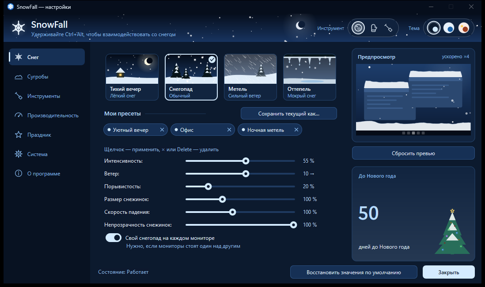
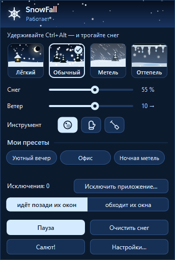
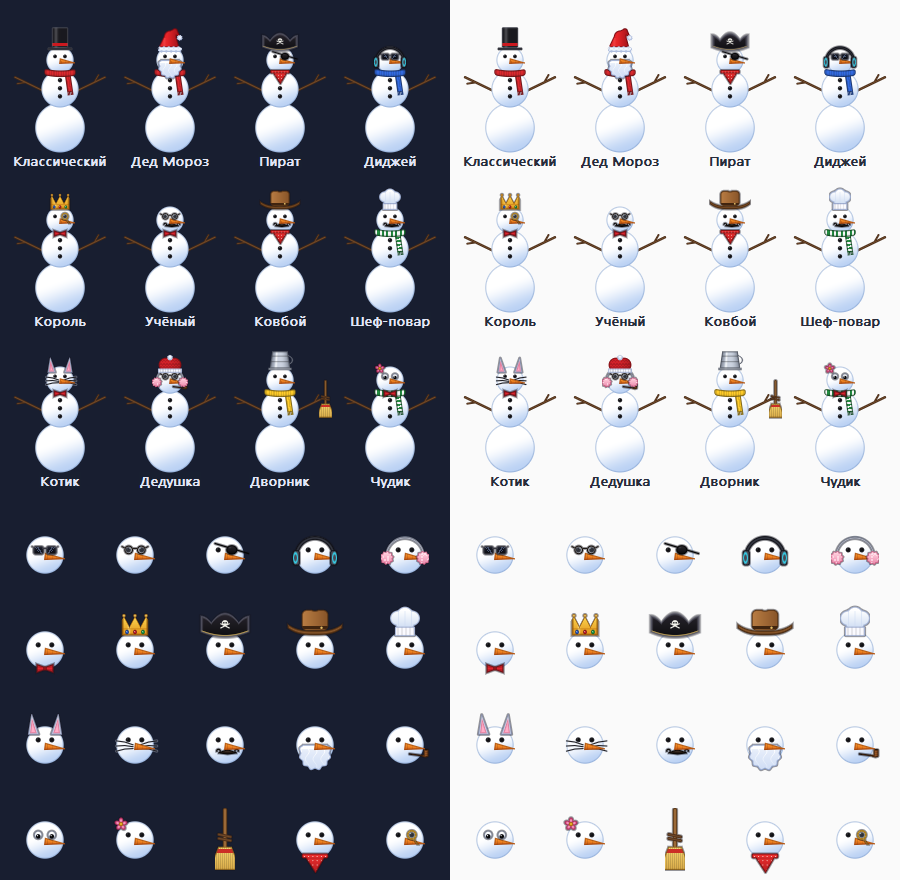
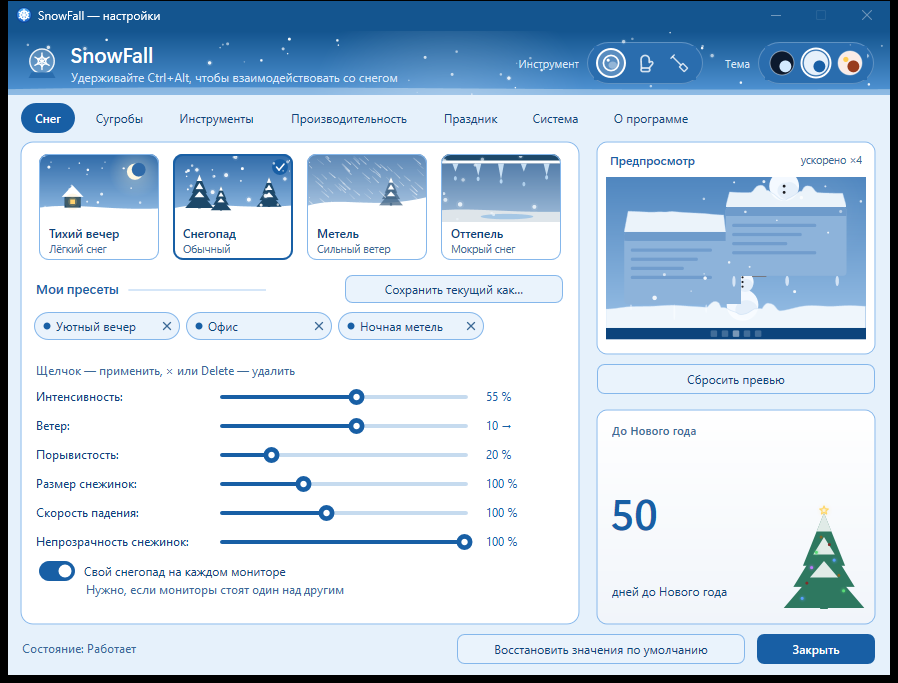
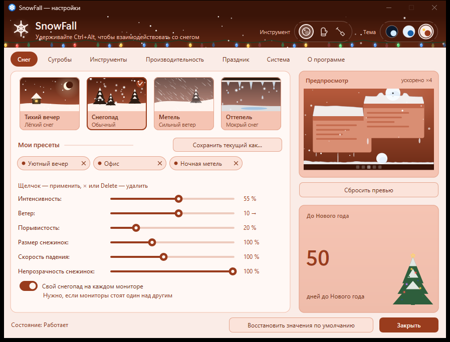

# SnowFall

Интерактивный снег на рабочем столе. Снежинки оседают на верхних кромках окон и на панели задач,
образуют сугробы и переезжают вместе с окнами. Снег можно смахнуть, зачерпнуть лопатой и
швырнуть, скатать снежок и бросить в окно, слепить снеговика руками или сложить из шаров.
Если панель задач завалит, её расчистит игрушечная снегоуборочная машинка.

**Платформа:** Windows 11 x64 (нативный C++20, Win32 + Direct3D 11). Планируется порт на
macOS — см. [platform/macos](platform/macos/README.md). [English README](README.md)



## Возможности

- **Снег живёт на рабочем столе:** сугробы на окнах, панели задач и низе экрана; прячутся
  за перекрывающими окнами, переезжают с окном, слетают кусками при рывке окна; неровные
  шапки; сосульки под долго лежащим снегом.
- **Погода:** «Лёгкий», «Обычный», «Метель», «Оттепель» (мокрый снег, тающие сугробы,
  капель); ветер и порывы; снег обтекает курсор, как зонтик.
- **Инструменты** (удерживайте `Ctrl+Alt` — подсказка с текущими клавишами есть в окне
  настроек — или включите режим взаимодействия):
  - **Снежок** — скатать шар из сугроба, бросить (в окно — шмяк!), сложить снеговика;
  - **Варежка** — нажать и держать на сугробе — вылепить снеговика; быстрый взмах — смахнуть снег;
  - **Лопата** — зачерпнуть и швырнуть снег, на месте падения вырастет сугроб; опрокидывает снеговиков.
- **Снеговики:** 12 скинов (Дед Мороз, пират, диджей, король, котик…), падают с неба при
  сильном снегопаде (частота настраивается), реалистично разваливаются от машинки и лопаты.
- **Праздник:** гирлянда на панели задач, салют в новогоднюю полночь или по кнопке.
- **Три темы окна настроек** с живым превью, быстрая панель у значка в трее, свои пресеты,
  исключения программ (снег идёт позади их окон или обходит их).
- **Лёгкий и приватный:** около 0,2–0,5 % CPU, ~35 МБ памяти, автопауза в полноэкранных
  приложениях, при блокировке и сне. Нет сети и телеметрии, содержимое чужих окон не
  читается, нет инъекций и прав администратора.

| Быстрая панель | Скины снеговиков |
|---|---|
|  |  |

| Тема «Снежный шар» | Тема «Новогодняя открытка» |
|---|---|
|  |  |

## Установка

Скачайте `SnowFallSetup.exe` в [Releases](../../releases): установка для текущего пользователя,
без прав администратора, удаление через «Параметры → Приложения». Есть и portable-zip.

> Сборки пока не подписаны, поэтому SmartScreen может предупредить при первом запуске.

## Использование

* **Значок в трее:** левый клик — быстрая панель, двойной — настройки, правый — меню.
* **Горячие клавиши** (меняются в настройках): `Ctrl+Alt+S` — пауза, `Ctrl+Alt+X` — очистить
  снег, `Ctrl+Alt+I` — режим взаимодействия.
* **Ключи запуска:** `--settings`, `--exit`, `--autostart`, `--data-dir <папка>` (портативный режим).
* Настройки: `%LOCALAPPDATA%\SnowFall\settings.json`, журнал — `snowfall.log` рядом
  (без заголовков окон и личных данных).

## Сборка

Нужны Visual Studio 2022 Build Tools (MSVC x64, Windows SDK 10.0.22621+), CMake ≥ 3.24, Ninja.

```bat
build.bat build Release          :: всё в build\
build\SnowFall.exe               :: запуск
```

Упаковка: `platform\windows\packaging\make_portable.bat` (zip),
`platform\windows\packaging\make_msix.bat` (MSIX без подписи); установщик `SnowFallSetup.exe`
собирается вместе с приложением. Тесты и структура репозитория — в [README.md](README.md) и
[docs/development.md](docs/development.md).

## Лицензия

SnowFall распространяется с открытым кодом по лицензии
[PolyForm Noncommercial 1.0.0](LICENSE.md): можно пользоваться, изучать, изменять и делиться
в личных и других некоммерческих целях. **Коммерческое использование — только по отдельной
лицензии**, пишите автору в [GitHub](https://github.com/DaveBugg) или
[Telegram](https://t.me/dave_cli).

Предложения изменений принимаются на условиях [CONTRIBUTING.md](CONTRIBUTING.md).

SnowFall — независимый проект, не связанный с другими программами «снега на рабочем столе».
