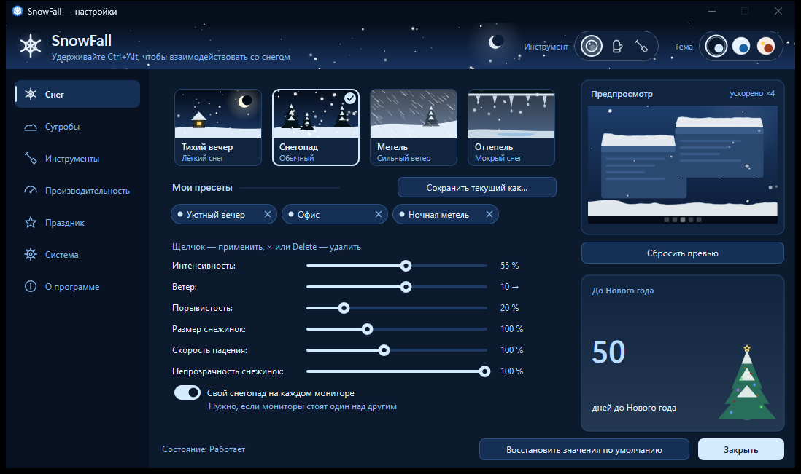
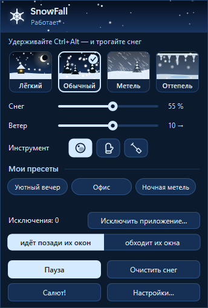
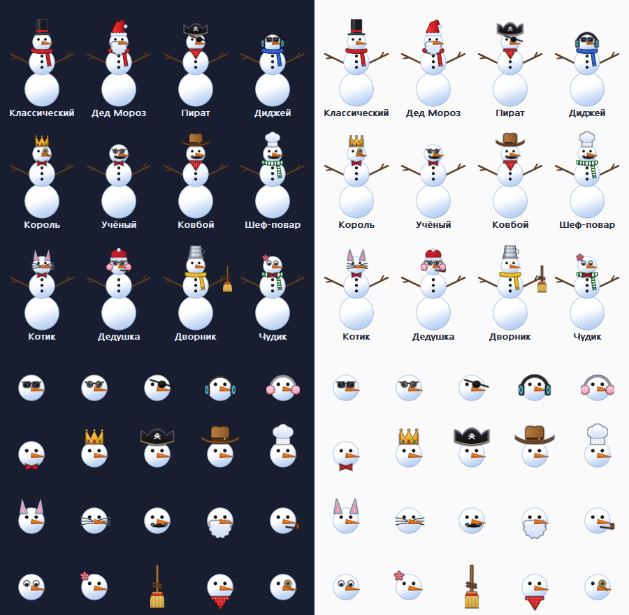
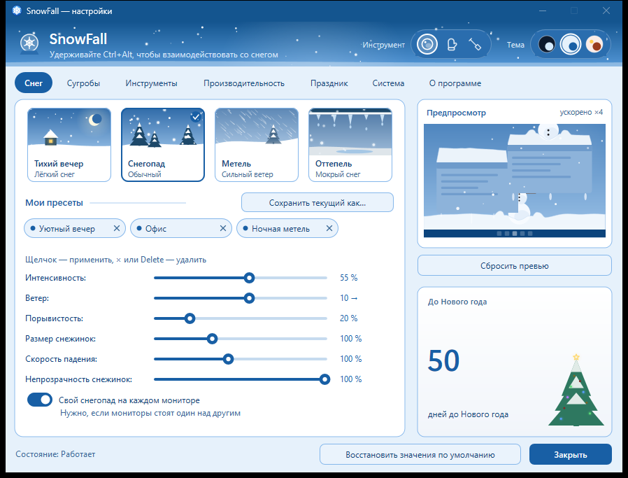
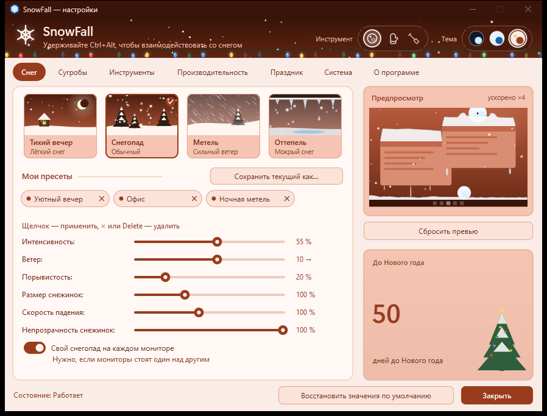

# SnowFall

Интерактивный снег на рабочем столе. Снежинки оседают на верхних кромках окон и на панели задач,
образуют сугробы и переезжают вместе с окнами. Снег можно смахнуть, зачерпнуть лопатой и
швырнуть, скатать снежок и бросить в окно, слепить снеговика руками или сложить из трёх шаров.
Если панель задач завалит, её расчистит игрушечная снегоуборочная машинка.

**Платформы:** Windows 11 x64 и, пока как тестовая сборка, macOS 13+ (Apple Silicon и Intel).
[English README](README.md)

**[Скачать последнюю версию](../../releases/latest)**



## Возможности

- **Снег живёт на рабочем столе:** сугробы на окнах, панели задач и низе экрана; прячутся
  за перекрывающими окнами, переезжают с окном, слетают кусками при рывке окна; неровные
  шапки; сосульки под долго лежащим снегом.
- **Погода:** «Лёгкий», «Обычный», «Метель», «Оттепель» (мокрый снег, тающие сугробы,
  капель); ветер и порывы; снег обтекает курсор, как зонтик.
- **Инструменты** (удерживайте `Ctrl+Alt` на Windows / `Ctrl+Option` на macOS или включите
  режим взаимодействия):
  - **Снежок** — скатать шар из сугроба, бросить (в окно — шмяк!); шары прилипают друг к другу,
    а из трёх шаров получается снеговик — с небольшим волшебным превращением;
  - **Варежка** — нажать и держать на сугробе — вылепить снеговика; быстрый взмах — смахнуть снег;
  - **Лопата** — зачерпнуть и швырнуть снег, на месте падения вырастет сугроб; опрокидывает снеговиков.
- **Снеговики:** 12 скинов (Дед Мороз, пират, диджей, король, котик…), падают с неба при
  сильном снегопаде (частота настраивается), реалистично разваливаются от машинки и лопаты.
- **Праздник:** гирлянда на панели задач, салют в новогоднюю полночь или по кнопке.
- **Три темы окна настроек** с живым превью, быстрая панель у значка в трее, свои пресеты,
  исключения программ (снег идёт позади их окон или обходит их).
- **Лёгкий и приватный:** около 0,2–0,5 % CPU, ~35 МБ памяти, автопауза в полноэкранных
  приложениях, при блокировке и сне. Нет телеметрии, содержимое чужих окон не читается, нет
  инъекций и прав администратора. В сеть программа обращается только для проверки обновлений,
  если вы это разрешили (вопрос задаётся один раз): один запрос к GitHub в сутки, без данных о
  вас; устанавливаются только подписанные релизы.

| Быстрая панель | Скины снеговиков |
|---|---|
|  |  |

| Тема «Снежный шар» | Тема «Новогодняя открытка» |
|---|---|
|  |  |

## Установка

**Windows 11 x64:** скачайте `SnowFallSetup.exe` в [Releases](../../releases/latest): установка
для текущего пользователя, без прав администратора, удаление через «Параметры → Приложения».
Есть и portable-zip.

> Сборки пока не подписаны, поэтому SmartScreen может предупредить при первом запуске
> («Подробнее → Выполнить в любом случае»).

**macOS 13+:** скачайте `SnowFall-<версия>.dmg` и перетащите SnowFall в «Программы». Приложение не
нотаризовано, поэтому при первом запуске macOS его не откроет («не удалось проверить» или
«повреждено»). Выполните в Терминале

```sh
xattr -cr /Applications/SnowFall.app
```

или нажмите «Готово», затем «Системные настройки → Конфиденциальность и безопасность →
Всё равно открыть». Чтобы трогать снег, нужно разрешение «Универсальный доступ» (приложение
попросит при первом удержании Ctrl+Option).

Обновления: «Настройки → О программе → Обновления» (или автоматически раз в сутки, если вы это
разрешили).

## Использование

* **Значок в трее** (Windows): левый клик — быстрая панель, двойной — настройки, правый — меню.
  На macOS так же работает снежинка в строке меню.
* **Горячие клавиши** (меняются в настройках): `Ctrl+Alt+S` — пауза, `Ctrl+Alt+X` — очистить
  снег, `Ctrl+Alt+I` — режим взаимодействия.
* Настройки: `%LOCALAPPDATA%\SnowFall\settings.json`, журнал — `snowfall.log` рядом
  (без заголовков окон и личных данных).

## Обратная связь

Ошибки и идеи — в [Issues](../../issues), лучше со скриншотом и журналом
(Windows: «Настройки → Производительность → Открыть папку журнала»; macOS:
`~/Library/Logs/SnowFall/snowfall.log`).

## Лицензия

SnowFall бесплатен для личного и другого некоммерческого использования по лицензии
[PolyForm Noncommercial 1.0.0](LICENSE.md). **Коммерческое использование — только по отдельной
лицензии**, пишите автору в [GitHub](https://github.com/DaveBugg) или
[Telegram](https://t.me/dave_cli).

В этом репозитории публикуются релизы; исходный код не публикуется.

SnowFall — независимый проект, не связанный с другими программами «снега на рабочем столе».
